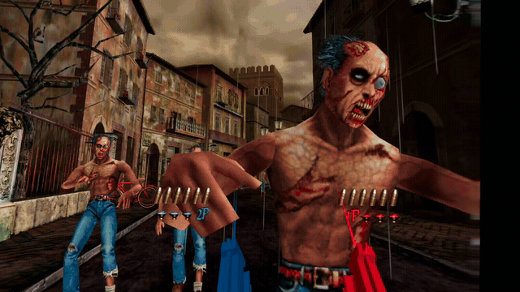
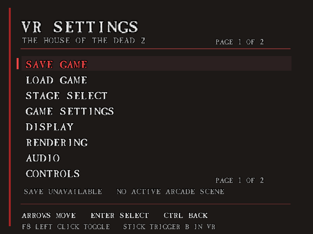

# HOTD2 PC2VR

Play the original Windows version of **The House of the Dead 2** in VR. Look around the scene and aim with your motion controllers as light guns. Save and load scene checkpoints, choose your starting stage and scene, and enable optional cheats.



## How to play

You need your own installed Windows PC copy of the game, a PC VR headset, and motion controllers. The Remake and emulated versions are not supported.

1. **Get the mod.** Download the Windows ZIP from [Releases](https://github.com/fjdiazt/hotd2-pc2vr/releases). If no ZIP is available, see [Build from source](#build-from-source).
2. **Install.** Extract the ZIP and place its **`vr`** folder beside your game's **`Hod2.exe`**. Keep all mod files inside `vr`.
3. **Connect your headset and controllers.** Start your usual PC VR software and make sure the headset is ready.
4. **Start the mod.** Open `vr` and double-click **`Start-HOTD2.bat`**. It finds and starts the game automatically.
5. **Start playing.** Put on the headset, face forward, choose **Arcade mode** with a thumbstick, and press **A/X** to confirm. The game moves you through the level; aim your guns and pull the triggers to shoot.

### Buttons you need

| What you want to do | What to press |
| --- | --- |
| Shoot | Pull that hand's **trigger**. |
| Reload | Press that hand's **grip**. You can also point the gun up, down or sideways away from your view and pull its trigger. |
| Navigate game menus | Move either **thumbstick**; press **A/X** or pull the **trigger** to confirm. |
| Pause or resume | Press **A/X**. |
| Skip a scene or go back | Press **B/Y**. |
| Recenter | Face forward and press the **right thumbstick button**. |
| Open or close VR Settings | Press the **left thumbstick button**. |

The right controller is Player 1; the left is Player 2. By default, **Akimbo** is on, so starting joins both players. Turn it off in **VR Settings > Controls** if you want each hand to join separately.

For Vive controllers, use the menu button for Start/Pause and the left/right trackpad clicks for Settings/recentering. On Index, use A/B on either hand.

When finished, choose **Quit game** in VR Settings to close both the game and its VR viewer.

## VR Settings menu

Press the **left thumbstick button** to open VR Settings.



- **Up/down:** select an item or scroll to the next page.
- **Left/right:** change the selected setting.
- **Trigger:** open the selected group or activate the selected action.
- **B/Y:** go back.
- **Left thumbstick button:** close and save.

**Settings does not pause the game.** Press **A/X** to pause or resume.

On the desktop, use **F8**, **arrow keys**, **Enter** and **Right Ctrl** to open the menu, navigate, select and go back.

The footer explains the selected option and shows any restart requirement. To restart, choose **Quit game** and launch the mod again.

## Settings explained

The menu starts with **Save game**, **Load game** and **Stage select**, followed by **Game Settings**, **Display**, **Rendering**, **Audio**, **Controls** and **Cheats**. **Reset defaults**, **Return to title** and **Quit game** follow the groups.

Defaults below apply to a fresh installation. Toggle values appear as **ON/OFF**. Options apply immediately unless a restart is listed; lighting and visibility changes made while paused apply when gameplay resumes.

### Game actions

| Action | What it does |
| --- | --- |
| **Save game** | Saves the current Arcade chapter and scene, including while paused. Loading restarts that scene; health, enemies and exact timing are not saved. |
| **Load game** | Restarts the saved scene, including from the title/menu. Shares one save slot with Autosave; the footer shows its destination. |
| **Stage select** | Choose a stage, then a scene, and confirm to start there. Some scenes depend on earlier events and may not work correctly in isolation. |
| **Reset defaults** | Restores all menu defaults and turns cheats off. |
| **Return to title** | Ends the run and returns to the title screen. Saves settings and keeps the checkpoint. |
| **Quit game** | Saves settings and closes the game and VR viewer. |

### Game Settings

| Option | Default | What it does |
| --- | --- | --- |
| **Skip startup logos** | On | Skips the SEGA/Empire boot logos. Game restart required. |
| **Autosave** | Off | Saves scene progress during Arcade play and resumes it on the next new Arcade start. Uses the Save game slot. |

### Display

| Option | Default | What it does |
| --- | --- | --- |
| **Brightness percent** | 90% | Brightness of the scene and guns; 100% is neutral. Leaves the HUD unchanged. Range: 25–400%. |
| **Gamma percent** | 220% | Adjusts picture tones; 100% disables correction. Range: 0–300%. |
| **Swap player HUD** | On | Places Player 1's ammo, lives and join/credit row on the right, and Player 2's on the left. Off uses the original layout. |
| **Desktop preview** | Off | Opens a separate desktop view of the reconstructed scene. Game restart required. |
| **Headset output** | On | Sends the game to your headset. Game restart required. |
| **Native windowed** | On | Runs the original game in a desktop window. Game restart required. |
| **Focus game** | On | Brings the game window to the front at startup. Viewer restart required. |

### Rendering

| Option | Default | What it does |
| --- | --- | --- |
| **World scale percent** | 125% | World size: 100% is original scale; 125% is 25% larger. Range: 10–1000%. |
| **Units per metre** | 10 | Base conversion from game units to VR metres. Leave at 10; adjust World scale for size. Range: 1–100000. Game restart required. |
| **Resolution percent** | 100% | Headset image resolution. Higher is sharper but costs performance. Range: 50–250%. Viewer restart required. |
| **MSAA** | 4 | Smooths jagged edges. Choices: 1 (off), 2, 4 or 8. Viewer restart required. |
| **Sharp HUD** | Off | Makes HUD sprites crisper. |
| **Native lighting** | On | Reproduces the game's lights, shading, highlights and fog. |
| **Expand meshes** | On | Keeps character parts visible beyond the original screen edges. |
| **Expand world** | On | Captures more loaded scenery beside and behind you. Experimental; may add glitches and PC load. |
| **Depth mode** | 2 | Surface ordering: 0 uses draw order, 1 uses game sorting values, 2 uses 3D depth. Viewer restart required. |
| **Depth bias** | 0 | Separates overlapping surfaces to reduce flicker. Range: 0–200. Viewer restart required. |
| **Background rendering** | On | Keeps drawing when another app has focus. Game restart required. |

### Audio

Volume sliders range from 0–100%.

| Option | Default | What it does |
| --- | --- | --- |
| **Master volume** | 100% | Overall game volume; 0 mutes it. |
| **Music volume** | 100% | Background music, multiplied by Master volume. |
| **Effects volume** | 100% | Gunshots, voices and other effects, multiplied by Master volume. |

### Controls

| Option | Default | What it does |
| --- | --- | --- |
| **Akimbo** | On | Shows both guns and joins both players together. Off allows each hand to join separately. |
| **Arcade gun colors** | Off | Red gun for Player 1, blue for Player 2. Off uses the original gun textures. |
| **Laser** | On | Shows aiming beams. |
| **Crosshair** | On | Shows aiming markers. |
| **Reload duration ms** | 180 | Gun reload animation length; native weapon timing still applies. Range: 60–1000 ms. |
| **Haptics** | On | Controller vibration after confirmed shots. |
| **Gun scale percent** | 100% | Size of the gun models. Range: 10–1000%. Viewer restart required. |
| **Aim reach metres** | 6 | Aiming distance over empty space. Shots hitting scenery use the actual hit distance. Range: 1–100 metres. |

### Cheats

Cheats apply to both players.

| Option | Default | What it does |
| --- | --- | --- |
| **Infinite ammo** | Off | Stops ammunition being used. If the gun is already empty when enabled, reload once. |
| **Infinite lives** | Off | Prevents life loss and the native damage handler's score/rank penalty. |
| **Invincibility** | Off | Blocks player damage, hit reactions and damage-related camera shake. Enemies still attack. |
| **Protect rescue NPCs** | Off | Prevents players from shooting rescue NPCs. Enemies and scripted events can still kill them. |
| **Infinite continues** | Off | Enables free play, so joining/continuing does not require credits. Confirm Continue after death. |
| **Rapid fire** | Off | Repeats shots while you hold the trigger. Reload gestures take priority. |
| **Shots per second** | 4 | Firing rate while Rapid fire is on. Range: 1–30; native weapon timing may limit it. |

## Technical details

### Features and integration

- Stereo VR with head tracking and controller aiming against captured world geometry.
- Right controller as P1, left controller as P2; paired akimbo or independent joining.
- Physical reload gesture, recoil and haptics.
- Floating menus and HUD, with separate laser and crosshair switches.
- G's File boss briefings at approximately one metre, preserving their animated 3D pages and native depth testing.
- Configurable world size, picture settings and optional cheats.
- Startup-logo bypass and native windowed startup through memory-only changes.

Your existing game installation stays in place. No HOTD2 game files are included or changed on disk.

### Requirements

- Your own working Windows PC copy of The House of the Dead 2.
- Windows x64, a Direct3D 11-capable GPU, and a PC VR headset with an active OpenXR runtime.
- Windows PowerShell 5.1 or PowerShell 7. Python and compilers are not required to use a release ZIP.
- The x64 `openxr_loader.dll` beside the viewer (included in release ZIPs).

Only this `Hod2.exe` build is currently supported:

```text
SHA256 C6B4116788B7F68C56860FB9CC8A94BF984E620907031E4BC3DB43623DBE579A
MD5    97C9E516A287AAB33A455A396DADAA45
```

The launcher checks the SHA256 before starting a game; native hooks also check their instruction signatures. Other executable layouts, the Remake, and emulated versions are outside the supported target.

### Download and run

Follow [How to play](#how-to-play) for installation. Each release ZIP contains a `vr` folder with the matching bridge, launcher, viewer, default settings, gun assets, x64 OpenXR loader, scripts, documentation and licenses. The `.zip.sha256` file contains the ZIP checksum.

The BAT launcher uses Windows PowerShell internally for executable validation and first-launch menu-font extraction. No terminal setup is needed. Keep its `build\` and `tools\` subfolders together inside `vr`.

Game discovery starts beside the launcher and checks each parent folder for `Hod2.exe`, choosing the nearest copy. It does not depend on the terminal's current folder. An unsupported nearest executable stops launch rather than falling back to another installation.

For a mod installed elsewhere, supply the path explicitly:

```bat
Start-HOTD2.bat -GameExe "C:\Games\TheHouseOfTheDead2\Hod2.exe"
```

All existing launcher options work through the BAT entry. `Start-HOTD2.ps1` remains available for direct PowerShell use.

### Build from source

Source builds require 32-bit MinGW GCC (`i686-w64-mingw32`) and Visual Studio C++ x64 build tools with a Windows SDK. Python 3 is used only by developer tests and optional diagnostic tools.

From the repository root:

```powershell
.\build.ps1
.\Start-HOTD2.bat -GameExe "C:\Games\TheHouseOfTheDead2\Hod2.exe" -Mode VR
```

Replace the example path with your game location when running from a separate source checkout.

The build produces `HOTD2Launch.exe`, `HOTD2Bridge.dll`, `HOTD2VR.exe`, the gun assets and `HOTD2VR.ini` under `build\`. It runs offline checks before reporting success. It copies an OpenXR loader from the configured local VR installation when available; otherwise place the official x64 loader in `build\` yourself.

Close any existing game session before launching. Keep the bridge and viewer from the same build together; their shared-memory formats must match.

#### Automated releases

Publishing a GitHub release, including a prerelease, runs `.github/workflows/release.yml` against its tagged commit. It builds on Windows, runs offline and packaging tests, creates the runtime ZIP and checksum, and attaches both to that release. Draft releases do not trigger a build. Assets appear after the workflow succeeds; a failed build leaves the release without new binaries.

The workflow also supports **Actions → Build release → Run workflow** for an inspection build. Manual runs save workflow artifacts and do not publish a release. Tag names used for packaging must start with a letter or digit and contain only letters, digits, dots, underscores or hyphens (maximum 80 characters). Reruns do not overwrite existing release assets.

To package a local build:

```powershell
.\package.ps1 -Version v1.0.0
```

The packager downloads Khronos OpenXR.Loader 1.1.65, verifies its pinned SHA256, checks binary architectures, and writes to `build\releases\`. It packages only listed runtime files and fresh repository defaults; local INI edits, generated fonts, checkpoints, logs and test executables are excluded. Offline/CI checks do not prove headset rendering or controller behavior.

#### Desktop previews and reconnecting

```powershell
.\Start-HOTD2.bat -GameExe "C:\Games\TheHouseOfTheDead2\Hod2.exe" -Mode Window
.\Start-HOTD2.bat -GameExe "C:\Games\TheHouseOfTheDead2\Hod2.exe" -Mode Stereo
```

`Window` shows the reconstructed scene on the desktop; `Stereo` shows both eyes side by side. These help distinguish capture/rendering problems from OpenXR problems.

To attach a new viewer to an already injected game, run `build\HOTD2VR.exe` directly, optionally with `--window --no-vrwindow` or `--stereo`. Closing the viewer leaves the game running; closing the connected game ends the viewer. `-Seconds 20` limits the viewer session without closing the game.

Desktop preview controls: W/A/S/D move, mouse drag turns, R resets, M cycles the floating panel through auto/on/off, and Escape closes the viewer when VR Settings is closed. F8 toggles VR Settings; arrows navigate, Enter confirms and Right Ctrl goes back/closes.

Under `[vr]`, `window` controls the existing reconstructed desktop preview and `vrwindow` controls headset rendering independently. The native game window stays available in every combination; `[bridge] windowed` only selects its windowed/fullscreen mode.

| `window` | `vrwindow` | Outputs besides native game window |
| --- | --- | --- |
| `0` | `0` | Native graphics with checkpoint, cheat and audio services; no capture hooks |
| `1` | `0` | Desktop preview |
| `0` | `1` | Headset (default) |
| `1` | `1` | Desktop preview and headset |

CLI overrides: `--window` / `--no-window`, `--vrwindow` / `--no-vrwindow`. For both outputs, use `HOTD2VR.exe --window --vrwindow` or `Start-HOTD2.bat -Window -VrWindow`. `-Mode Window` selects preview only; `-Mode VR` enables the headset while preserving the INI preview setting. With no explicit mode/switches, the INI selects both outputs. `--stereo` remains a separate desktop diagnostic mode.

The launcher applies these same flags before bridge injection. Both outputs off skips graphics capture, lighting reconstruction, culling expansion and native pause replay while retaining checkpoint, cheat and audio services. `HOTD2VR.exe` then runs its existing service loop without D3D11/OpenXR or synthetic aiming. Changing whether capture hooks are installed requires a game restart through the launcher; reconnecting a viewer alone cannot remove or install those hooks.

With both outputs enabled, the preview uses the existing independent desktop camera and runs read-only; only the VR viewer sends controller input, cheats and audio controls. Closing the preview leaves the headset and native game running. Closing the VR viewer closes its preview; closing the native game ends both. This is not a left-eye mirror. Running both renderers costs additional CPU/GPU work.

### Controls

See [Buttons you need](#buttons-you-need) for controller bindings.

Trigger supplies native Start and Fire; A/X supplies Start and Pause. The pause reader accepts A/X press edges and ignores synthetic trigger Start, preserving native pause eligibility, player ownership and device-disconnect behavior. Physical Enter/Tab retain native Start/Pause. Matching protocol-24 bridge/viewer builds are required.

Gesture reload uses the tracked gun's direction relative to the headset: up **50°**, down **45°**, or sideways **60°**, then trigger. Scripted camera motion and recenter offsets do not change these thresholds. Each pull stays a shot or reload until release; tracking loss disarms it until release. Two signature-checked weapon reads separate Grip Reload from B/Y Skip/Cancel while preserving native reload rules and physical Ctrl behavior.

#### Player HUD placement

`[vr] swap_player_hud=1` (default) moves converted gameplay ammo, lives and join/credit rows to match the fixed gun assignments: P1 on the right, P2 on the left. Player labels, Original-mode weapon counts and reload messages/hints move with their row. The inactive player's PRESS START/INSERT COIN prompt and CREDIT/FREE PLAY indicator follow that player's side. Text, digit order, artwork, animation and HUD depth stay intact. Each row is aligned to the opposite side using its complete bounds; its width can vary with ammo/lives or messages.

Set `swap_player_hud=0`, use viewer `--no-swap-player-hud`, or launcher `-NoSwapPlayerHud` to retain the native layout. `--swap-player-hud` / `-SwapPlayerHud` enable it. Last direct CLI switch wins; the launcher rejects opposing switches. The flag works independently of `akimbo` and never changes controller/player assignments.

Ownership comes from the native player ammo/lives draw routines and gameplay credit-line routine, including deferred sprite copies. The global attract-screen PRESS START prompt, shared artwork elsewhere, captions, menus, world geometry and briefing-book geometry are retained. This change affects converted HUD geometry in the headset/desktop preview. The native game window and native framebuffer panels keep their original pixels and layout. Matching protocol-24 bridge/viewer builds are required. Ammo/lives placement with akimbo and the gameplay join/credits swap are user-confirmed in VR. Full mode, transition and authored-HUD coverage remains unverified.

#### Experimental Save game and scene selection

To start a new Arcade game at another chapter, use `./Start-HOTD2.bat -StartStage 6`. `-StartStage` accepts 1–6. Optional `-StartScene 3` selects the native zero-based scene ID within that stage; omitted scene uses the chapter entrance (scene 7 for chapter 3, scene 0 for the others). These options change the next **new Arcade start after the normal menus**, rather than jumping immediately from the title. Original, Training, Boss and attract modes keep their native behavior.

Enable `[vr] continue_game=1` to record the latest Arcade stage/scene and resume it on subsequent new Arcade starts. Default is `0`. Launcher switches `-ContinueGame` / `-NoContinueGame` override this for one launch; opposing PowerShell switches are rejected. Explicit `-StartStage` / `-StartScene` take priority over the saved location. With recording enabled, subsequent scene changes update the checkpoint even after an explicit jump.

Load and Stage select rebuild through native mode/task/resource initialization, resuming native pause when necessary. They override startup stage/scene options and preserve joined players; loading from a menu joins P1, or both players with Akimbo enabled.

**Game Settings > Autosave** updates `continue_game` live. Save/Load destinations refresh while the menu is open; requests show progress until the bridge acknowledges a result. Missing or invalid saves leave the current game intact. Manual Save/Load work with Autosave disabled.

The checkpoint API uses `checkpoint_action` (`HOTD_CHECKPOINT_SAVE`, `HOTD_CHECKPOINT_LOAD`, `HOTD_CHECKPOINT_TITLE` or `HOTD_CHECKPOINT_SELECT`) and an incremented nonzero `checkpoint_request`, published after a memory barrier. SELECT also supplies `checkpoint_target_stage` and `checkpoint_target_scene`. Wait for the matching `checkpoint_response` before reading the result and destination. The legacy `HOTD_CHECKPOINT_NEW` command remains accepted for compatibility. Serialize callers; companion previews map the frame read-only. The game thread handles file writes and transitions while the viewer polls. Load acknowledgment waits for destination activation, with a 30-second bridge timeout. The viewer reports an unknown result after 45 seconds without releasing request ownership. Heartbeat-owned `checkpoint_autosave` uses 0 for launch configuration, 1 for off and 2 for on; disconnect restores launch configuration.

The bridge stores `[checkpoint] version=1`, `stage=1..6` and `scene=0..255` in `HOTD2VR.checkpoint.ini` beside its DLL, separate from both configuration and native game saves. It writes only when the location changes during active Arcade gameplay, using a flushed temporary file and atomic replacement. No player health, score, inventory, enemy state, route history or exact script position is saved. Resume restarts the selected scene. Disabling the feature retains the file; deleting it starts normally until another checkpoint is recorded.

Direct launcher equivalents: `HOTD2Launch.exe path-to-Hod2.exe --start-stage 6 --start-scene 3 --continue-game`; `--no-continue-game` disables recording/resume. These flags belong to the launcher. `--native-window` skips bridge injection and cannot be combined with a checkpoint request. Stage/scene choices are launch options or menu actions; only Autosave is stored as an INI preference.

Invalid numeric arguments report `Invalid stage 20` or `Invalid scene 256` before starting a process. A missing direct-launcher value reports `Invalid stage` or `Invalid scene`.

This is a debugging checkpoint facility, **not a full save state**. Scene IDs are script boundaries, not labeled or validated checkpoints. Startup Arcade-script entries are checked before use; unavailable startup entries fall back to a normal chapter-1 start and log rejection. Live Load validates the saved destination against bounded, relocated native event tables on disk before requesting a transition; invalid destinations report failure without unloading the current scene. Mid-scene starts run the scene's native variant-0 setup script before its variant-1 gameplay script when available, loading its section/resources through the normal event system. Chapter entrances retain the native variant choice. Valid scripts can still depend on earlier flags, actors or route choices, or lack complete setup. Those prerequisites and full chapter/scene coverage need runtime qualification. Failed writes retain the previous file and retry after five seconds; startup and save results appear in `HOTD2Bridge.log`.

#### Pausing

A/X pauses or resumes with Settings open or closed. VR and the injected desktop window retain the last complete scene and HUD, hiding the native pause backdrop/text. Head and controller tracking continue so you can look around the frozen scene.

Desktop pause redraws retained geometry and textures through Direct3D 7. It needs an injected bridge and a previously rendered gameplay scene; the native view uses its own picture settings.

#### VR Settings

See [VR Settings menu](#vr-settings-menu) for navigation and [Settings explained](#settings-explained) for every option. The native-font panel has a 50% opaque background. It consumes menu input before firing, reload, join or skip; A/X pause and recenter remain available.

Live options update the viewer and bridge heartbeat. Brightness/Gamma rebuild their shaders; lighting and visibility flags affect subsequent captured frames. The menu identifies viewer/game restart requirements. Gun model paths remain INI-only.

Edited settings save to `HOTD2VR.ini` beside the viewer when the panel closes or the viewer exits normally. Default values remove their keys. Saves atomically replace the INI and keep timestamped `.menu-*.bak` backups; untouched keys and comments survive. A failed menu close leaves the panel open for retry. Opening and closing without edits writes nothing.

Reset defaults removes overrides for all menu options, including CLI overrides, when the panel closes. Hidden/unknown INI keys, gun paths and native game options are preserved. Return to title uses native mode 3 and closes the panel after acknowledgment. Quit game saves options and sends the verified native window its normal close request; an unavailable window or save failure leaves the panel open.

`[vr] menu=0` or `--no-menu` disables the panel; `--menu` enables it. A missing/invalid extracted `menu-font.rgba` also disables it with a log message. The original Game Options screen is separate.

Keyboard input works while the native game or viewer has focus. In addition to the controls above, Tab/Left Ctrl provide P2 confirm/back, and Backspace/Escape are back aliases. Keyboard Back closes the root page; controller B/Y stays at the root. Companion previews are read-only; focus the native game to edit during a combined session.

The panel renders in the native window, desktop preview and headset. Disabling both outputs also disables capture and Settings while retaining checkpoint, cheat and audio services. Native composition happens after capture to avoid a duplicate panel in framebuffer views.

Matching protocol-24 bridge/viewer builds are required. Protocol 24 assigns command 3 to Return to title and command 4 to Stage select, rejecting older conflicting assignments. See [menu integration](docs/vr-menu.md) and [protocol/pause notes](docs/pause.md).

#### Two hands and akimbo

Player assignments are fixed: right is P1, left is P2.

- `akimbo=1`: both guns appear from startup. Either hand's Start requests both players, so one menu confirmation joins both.
- `akimbo=0`: each hand joins its own player. Gun visibility follows native player status, including accepted joins waiting through a cutscene. A rejected join, continue countdown, game over or return to menus does not leave an inactive gun visible.

Firing and tracking loss do not swap player identities. A hidden hand's held trigger must be released before it can fire after joining. Recenter and menu navigation remain available before joining.

### Configuration

Edit **`build\HOTD2VR.ini`**, beside the executables. The root `HOTD2VR.ini` supplies defaults for a new build directory; later builds preserve the active file. Command-line switches override the INI for that launch without saving changes.

After editing the INI, restart the viewer. Output flags (`window`, `vrwindow`) and `[bridge]` changes require a game restart. Direct CLI flags use the last supplied value; the PowerShell launcher rejects opposing switches.

#### Audio volume

```ini
[vr]
master_volume=100
music_volume=100
effects_volume=100
```

Audio values are percentages from 0 to 100. Master and category gains multiply: Master 50 and Music 40 produce 20% of the original music level. These controls affect game DirectSound audio.

For music and effects muted, without changing the INI:

```powershell
.\Start-HOTD2.bat -MusicVolume 0 -EffectsVolume 0
.\build\HOTD2VR.exe --music-volume 0 --effects-volume 0
```

Use `-MasterVolume N` or `--master-volume N` for overall volume. Missing or invalid INI values use 100; invalid CLI values are rejected. The launcher forwards only explicitly supplied overrides. Values reach the game when the viewer connects and remain for that game process. Audible game/headset verification remains pending.

#### World scale

```ini
[vr]
worldscale=1.25
```

World scale is a multiplier: **1** restores the previous size, **1.25** makes the world 25% larger, **0.8** makes it 20% smaller, and **2** doubles it. Allowed range: 0.1–10. Missing or invalid values fall back to 1.25. Convert older percentage settings by dividing by 100 (`140` becomes `1.4`).

Use `Start-HOTD2.bat -WorldScale 1.25` or `HOTD2VR.exe --world-scale 1.25` for a session override. Geometry and controller-ray conversion share the scale; HUD/menu size and controller gun size stay fixed. `[bridge] units_per_metre` remains the base conversion from native game units, not this multiplier.

#### Laser and crosshair

```ini
[vr]
laser=1
crosshair=1
```

`laser=0` hides the beam and muzzle flare; `crosshair=0` hides the VR ring, core and ticks. Both settings affect both hands. Lasers/crosshairs use scarlet for P1 and cobalt for P2, with brighter firing feedback, regardless of the gun appearance setting.

Session overrides:

```powershell
.\Start-HOTD2.bat -GameExe "C:\Games\TheHouseOfTheDead2\Hod2.exe" -NoLaser -NoCrosshair
.\build\HOTD2VR.exe --no-laser --no-crosshair
```

Use `-Laser` / `-Crosshair` or `--laser` / `--crosshair` to enable either over a disabled INI setting.

Native gameplay crosshairs are omitted automatically from converted geometry for both players and all four native styles. Options previews and native desktop rendering stay intact. These switches control only the generated VR aiming graphics. The legacy positional `hidecross` setting is no longer used; existing copies are ignored. A native framebuffer panel still mirrors the desktop pixels, including its crosshair.

#### Advanced graphics

```ini
[vr]
native_lighting=1
```

`native_lighting=0` bypasses native light queries, normal preparation and per-vertex lighting, including specular and fog. Menus and HUD keep their native colors.

Session overrides (INI remains unchanged):

```powershell
.\Start-HOTD2.bat -GameExe "C:\Games\TheHouseOfTheDead2\Hod2.exe" -NoNativeLighting
.\build\HOTD2VR.exe --no-native-lighting
```

Use `-NativeLighting` or `--native-lighting` to enable it. Rebuild and restart both bridge and viewer when upgrading the capture format.

Lighting adds CPU work; VR frame-time cost remains unmeasured.

`brightness` scales scene/gun color after fog and specular, before sRGB gamma compensation. It applies with native lighting on or off; HUD, aim graphics and framebuffer panels use their own colors. See [Display](#display) for its range and default.

For 80% scene brightness, without changing the INI:

```powershell
.\Start-HOTD2.bat -Brightness 80
.\build\HOTD2VR.exe --brightness 80
```

Invalid CLI brightness values are rejected.

#### Visibility expansion

```ini
[vr]
expand_meshes=1
expand_world=1
```

`expand_meshes=1` preserves the existing normal-model screen-edge expansion, helping retain offscreen body parts. Set it to `0` to restore native normal-model mesh rejection. Alternative-model draws retain their native visibility checks by default.

`expand_world=1` captures loaded static scenery beyond the original camera by following deferred stage submissions and relaxing their near/far rejection. Custom clip planes, face culling and viewer depth testing remain active. Unloaded sections and surfaces the game never supplies can leave gaps. Extra submissions increase CPU and geometry/texture pressure. Earlier headset tests captured rear scenery with jerkiness and artifacts; full rear coverage and forward-wall parity remain unverified.

Session overrides, without changing the INI:

```powershell
.\Start-HOTD2.bat -ExpandWorld
.\build\HOTD2VR.exe --expand-world
```

Overrides: `-ExpandMeshes` / `-NoExpandMeshes`, `-ExpandWorld` / `-NoExpandWorld`, or viewer flags `--expand-meshes` / `--no-expand-meshes`, `--expand-world` / `--no-expand-world`. Matching bridge/viewer builds are required.

#### Other shipped settings

INI keys for the options above, plus the gun asset path:

| Section/key | Value | Purpose |
| --- | --- | --- |
| `[vr] akimbo` | `1` | Paired joining; `0` uses independent player joining |
| `[vr] arcade_gun_colors` | `0` | Shaded arcade plastic instead of gun textures; live Controls toggle |
| `[vr] gunmodel` / `gunscale` | `gun.obj` / `100` | Gun asset and its size in percent |
| `[vr] depth` / `depthbias` | `2` / `0` | Reconstructed depth buffer and optional sort bias |
| `[vr] expand_meshes` / `expand_world` | `1` / `1` | Normal-model side expansion; experimental loaded-stage rear capture |
| `[vr] msaa` | `4` | Antialiasing samples: 1, 2, 4 or 8 |
| `[vr] supersample` | `100` | Eye-buffer resolution in percent; separate from world size |
| `[vr] gamma` | `220` | sRGB eye-buffer compensation in percent; `100` disables it |
| `[vr] brightness` | `90` | Converted-scene and gun brightness in percent, 25–400; HUD unchanged |
| `[vr] master_volume` / `music_volume` / `effects_volume` | `100` / `100` / `100` | Game audio percentages, 0–100; effects include voices |
| `[vr] hudsharp` | `0` | Sharp HUD texture filtering; explicit `1` enables it |
| `[vr] haptic` / `focusgame` | `1` / `1` | Shot feedback and initial native-window focus |
| `[bridge] windowed` / `background` | `1` / `1` | Native windowed mode and rendering while another window has focus |
| `[bridge] units_per_metre` | `10` | Initial native-unit conversion; headset calibration remains necessary |

The [shipped INI](HOTD2VR.ini) contains no overrides. Relative gun-model paths resolve beside the viewer. Both gun styles use the viewer Brightness/Gamma settings. Arcade shells are untextured scarlet/cobalt plastic with local face shading and soft highlights; gun lighting does not sample level lights or shadows.

#### Startup splashes and native window

`[bridge] skip_splash=1` starts at the title, skipping SEGA/Empire logos. Use `skip_splash=0`, `Start-HOTD2.bat -ShowSplash` or launcher `--show-splash` to restore them; `-SkipSplash` / `--skip-splash` enables the bypass. Launcher flags also work with `--wait` and `--native-window`.

Optional `[bridge] launchfix=1` bypasses the supported game's CD check in memory before startup. The launcher checks the original instruction signature, changes one branch displacement, restores memory protection and verifies the result. Unsupported code stops launch. The default is off; set it in `build/HOTD2VR.ini` to enable. `Hod2.exe` stays unchanged; setting `launchfix=0` restores the original check on the next launch. Installed game data is still required.

The launcher validates the startup instruction and changes one byte while the process is suspended, preserving normal initialization. The bridge selects native 640×480 windowed mode, keeps the game rendering in the background, and accepts the known renderer-selection and quit-confirmation dialogs. Back retains its native action; quit confirmation is accepted whenever the game asks it. Other dialogs retain normal behavior.

For a native windowed comparison with the original splash sequence, without the capture bridge or viewer:

```powershell
.\build\HOTD2Launch.exe "C:\Games\TheHouseOfTheDead2\Hod2.exe" --native-window --show-splash
```

For native graphics with no graphics hooks:

```powershell
.\Start-HOTD2.bat -NoGraphicsHooks -StartStage 4 -StartScene 0 -NoContinueGame
```

Start a new Arcade game through the normal menus to enter the selected scene. Native keyboard/mouse controls remain available. Existing cheat and volume flags still work; ammo, lives, invincibility and free-play controls do not require conversion rendering. Rapid fire remains tied to VR trigger input and supplies no physical mouse auto-fire in this mode.

`-NoGraphicsHooks` (launcher `--no-graphics-hooks`) forces both conversion outputs off regardless of INI/output flags. Services run from the native input update, with no presentation, DirectDraw/Direct3D, model/texture, culling, lighting, pause-renderer hooks or framebuffer readback. The normal native windowed selection and optional CD/splash startup patches still apply. The existing `-NoWindow -NoVrWindow` combination uses the same services path.

Use `-ContinueGame` to resume the saved checkpoint. The shared-memory checkpoint API also works in this mode, but Settings is unavailable. Close the existing game before launching another session.

Direct bridge launch: `HOTD2Launch.exe path-to-Hod2.exe --no-graphics-hooks --start-stage 4 --start-scene 0 --no-continue-game`; attach `HOTD2VR.exe --no-window --no-vrwindow` to publish configured cheats/audio. `--native-window` remains the separate comparison mode without any bridge injection.

For the bat-wing investigation, optional `[bridge] trace_bats=1` records only chapter 4, scene 0 bat models `0x1B01..0x1B09` while unpaused. It buffers four frames at least 15 game frames apart, capped at 256 draw records, then writes `HOTD2BatTrace-<pid>-<tick>.bin` plus layout metadata `.json` and matching native-frame BMPs beside the bridge. Pause or scene exit flushes an already started partial trace. Each draw retains the native model record, matrices, material/lights, up to 256 input vertices and 768 converted vertices; truncation is marked. Capture-disabled launches install no trace. Default is off; no rendering state is changed by the trace. The final bounded write can cause a brief hitch, so this is diagnostic output rather than a performance benchmark. Inspect it with `python tools/read_bat_trace.py path-to-trace.json`.

Other diagnostics also default off: `[bridge] trace_render_states=1` enables render-state sampling (at most 32 distinct states, sampled every 30 frames), and `trace_input=1` enables per-shot/reload log lines. Restart the game to change them. Ordinary startup, failure and periodic health logs remain available. Native mode with graphics hooks disabled does no render-state sampling.

Native renderer and quit questions remain in this comparison mode. Starting `Hod2.exe` normally retains its original behavior.

### Optional cheats

All default off. Enable for a session:

```powershell
.\Start-HOTD2.bat -GameExe "C:\Games\TheHouseOfTheDead2\Hod2.exe" -InfiniteLives -InfiniteAmmo -Invincibility -ProtectRescueNpcs -InfiniteContinues -RapidFire -RapidFireRate 4
```

Choose the flags you need. Viewer equivalents: `--infinite-lives`, `--infinite-ammo`, `--invincibility`, `--protect-rescue-npcs`, `--infinite-continues`, `--rapid-fire`, `--rapid-fire-rate 4`.

| Cheat | INI key under `[vr]` |
| --- | --- |
| Infinite ammo | `infinite_ammo=1` |
| Infinite lives | `infinite_lives=1` |
| Invincibility | `invincibility=1` |
| Protect rescue NPCs | `protect_rescue_npcs=1` |
| Infinite continues | `infinite_continues=1` |
| Rapid fire | `rapid_fire=1` |
| Shots per second | `rapid_fire_rate=4` |

Rapid fire defaults to **4 shots/sec**; whole-number rates 1–30 are accepted. Native timing and weapon handling can lower the actual rate. Reload gestures take priority; menus, pause, cutscenes, inactive players and stale input receive no repeated shots. The rate override does not enable rapid fire by itself. Visual recoil retains its trigger-press behavior. Rumble follows confirmed native shots for each player, including Original-mode weapons: one 30 ms pulse at the existing fixed strength, capped at 10 pulses/sec per controller. The cap never changes firing rate. Excess feedback is dropped without a backlog; empty pulls, reload gestures, menus, pause and tracking loss produce no firing rumble. `haptic=0` disables it. Headset feel and performance remain to be verified.

While the viewer heartbeat is fresh, lives/ammo and free-play settings override the native settings: `0` forces off, `1` forces on, for both players. Changing an option to `0` does not restore a pre-enabled native cheat. The bridge saves prior native values when the viewer takes ownership, restores them on viewer exit or heartbeat expiry (500 ms), and captures them again on reconnect. Invincibility off lets native damage run normally. Credit counts are not rewritten, and the bridge does not edit save files. Unsupported instruction signatures leave the affected feature unavailable and produce a log entry. Rebuild and restart both game and viewer together when updating cheat support. Full-game attack and continue coverage still needs runtime qualification.

Implementation and test evidence: [docs/cheats.md](docs/cheats.md).

### How it works

1. The x86 launcher creates `Hod2.exe` suspended, applies selected startup changes, injects `HOTD2Bridge.dll`, then resumes the game.
2. The HOTD2 bridge hooks DirectDraw/Direct3D7 submissions. It captures geometry, textures and the live projection, reconstructs pretransformed vertices, and retains native material, blending, alpha-test and culling information.
3. Coherent frames and a texture atlas pass through shared memory to the separate x64 Direct3D11/OpenXR viewer.
4. The viewer renders the scene for both eyes. Controller rays intersect world geometry; the hit projects through HOTD2's camera back into each player's native gun input. HUD and shot-effect geometry are excluded from aim intersections.

The upstream renderer uses `HGL_VIEW.DLL` integration and extra rotated-camera passes. HOTD2 uses an injected capture bridge with configurable mesh/stage visibility expansion. Experimental `expand_world` broadens loaded stage submissions without rotating the camera or retaining scenery across frames. Full 360-degree coverage is not established: other culling, unloaded sections and never-authored surfaces can still leave gaps when you turn or lean.

The bridge also repairs alpha after native bitmap uploads so menu art remains visible. Screen-space UI is captured in every game mode, including tutorial, story, game-over and menus, without a native depth cutoff. It uses a canvas 2 m away and 2 × 1.5 m in size, anchored to the recenter origin. Native transparency and submission order remain; UI draws above world geometry and never becomes an aim or splash target. The captured-screen panel replaces that HUD layer when its texture is available, avoiding duplicate UI. Model geometry, including untagged traveling tracers, keeps its world depth. Native letterbox bars are omitted from VR capture. During pause, VR retains the last gameplay scene; full-screen blackouts outside pause remain captured. These capture changes leave the native game rendering path running.

Texture capture preserves each material's independent U/V wrap, mirror and clamp modes. World and HUD shaders apply addressing after UV interpolation, preserving the native mapping on mirrored model halves. Opening-car material inspection and offscreen viewer replay passed; boss/headset appearance still needs confirmation. Rebuild and restart both bridge and viewer after capture-format changes.

### Troubleshooting and current limits

- **Unsupported executable:** compare the game's hash with the supported build above. This is an exact-build integration.
- **No bridge / protocol mismatch:** launch through `Start-HOTD2.bat`, close stale game/viewer sessions, and rebuild the bridge and viewer together. A viewer alone cannot inject an already running unmodified game.
- **OpenXR fails but desktop preview works:** check the active runtime, headset connection and x64 loader beside the viewer.
- **Unexpected settings:** check `build\HOTD2VR.ini`, not only the root template. Rebuilding preserves existing values.
- **Missing surfaces or rendering glitches:** capture cannot supply geometry the game never submits. Texture-atlas capacity, mutable textures, transparency ordering and broader scene coverage remain areas for qualification.

Core 3D rendering, startup centering, controller shooting, close aiming, reload, the mode-selection menu, gameplay HUD placement and letterbox removal have user headset confirmation. World-scale changes, laser/crosshair toggles, independent-player presentation, exact reload thresholds, broader UI/mode coverage, stereoscopic comfort and full-game compatibility still need further headset checks. Native cheat activation/restoration passed desktop checks; damage protection, P2 gameplay and Original-mode weapons still need runtime confirmation. Offline or desktop success does not establish those results. Detailed evidence and remaining checks live in [docs/findings.md](docs/findings.md).

### Validation

`build.ps1` runs offline checks for capture/projection, native input signatures and trigger edges, startup patches, cheat restoration and rapid-fire guards, texture-cache behavior, coherent frame snapshots, scale and indicator options, and offscreen Direct3D11 rendering. These checks start neither the game nor OpenXR.

With an injected game already running:

```powershell
python .\tests\test_live.py
python .\tests\test_live.py --input
```

Close the viewer before the `--input` check. It briefly drives both aim coordinates without firing, then checks watchdog expiry and the native axis-write instructions. Logs and diagnostic images stay under ignored `build\`.

For the chapter-4/scene-0 bat comparison, close game/viewer/VR sessions, then run:

```powershell
python tools/capture_bats.py --game 'N:\games\systems\pcvr\bin\TheHouseOfTheDead2\Hod2.exe' --re-source 'C:\src\gaming\hotd2-re' --runtime build/bat-trace-stage/build
```

This diagnostic build reuses the RE project's autoplay selector and gun calibration. It shoots opening enemies through normal gun input, permanently stops firing when live bats appear, and captures at a nearest-bat distance of 30 game units. It runs native graphics and desktop conversion separately with `launchfix=1`, never enables OpenXR, and closes its own game/viewers afterward. Native mode explicitly uses `--no-graphics-hooks` and takes its screenshot externally, without pausing or reading the game's D3D device. That screenshot can follow the actor snapshot by several game frames; it is not an exact-frame comparison. Each run has an isolated INI/checkpoint under `build/bat-bot-*`; normal builds and game configuration stay untouched. Output includes native actor records/transforms, desktop screenshots, and converted-frame/atlas evidence. Both modes reached the bat capture in desktop testing; see [findings](docs/findings.md#bounded-bat-autoplay-diagnostic-2026-10-22).

### Removal and rollback

Close the viewer and game, then remove the `vr` folder to uninstall. Keep `vr\build\HOTD2VR.ini` and `vr\build\HOTD2VR.checkpoint.ini` if you want to preserve settings and saved progress. Hooks and startup changes disappear with the game process; the original `Hod2.exe` and `Hod2.ini` remain unchanged.

## Credits

The viewer is adapted from [NeuralF's Virtua Cop 2 VR (VC2VR)](https://github.com/NeuralF/Rea-Virtua-Cop-2-VR). Its OpenXR/shared-memory approach, controller handling, sights, gun rendering and recoil provided the foundation. The launcher, Direct3D7 capture and native input integration are specific to HOTD2. The upstream MIT copyright notice is retained in [LICENSE](LICENSE).
- **Gun assets bundled with VC2VR:** the Emerald revolver OBJ, material and texture, reused for both hands. The [upstream model header](https://github.com/NeuralF/Rea-Virtua-Cop-2-VR/blob/d99da1e6795ead74ac1bd9f24eec1a89e414ca62/gun/gun.obj) labels it “Emerald revolver (Meshy)”. No separate artist name or original model-page link was found in the checked upstream files. See [asset provenance](THIRD-PARTY.md#gun-model-and-texture).
- **[The Khronos Group](https://github.com/KhronosGroup/OpenXR-SDK):** OpenXR headers and loader.
- **[Argonlefou / DemulShooter](https://github.com/argonlefou/DemulShooter):** HOTD2 input-location and keyboard-convention reference, cross-checked against the supported executable. No DemulShooter code is included.

Full component and asset notes: [THIRD-PARTY.md](THIRD-PARTY.md). The House of the Dead 2 and its game imagery belong to their respective owners; this independent fan mod is not affiliated with or endorsed by Sega. No HOTD2 or Virtua Cop 2 game files are distributed here.
